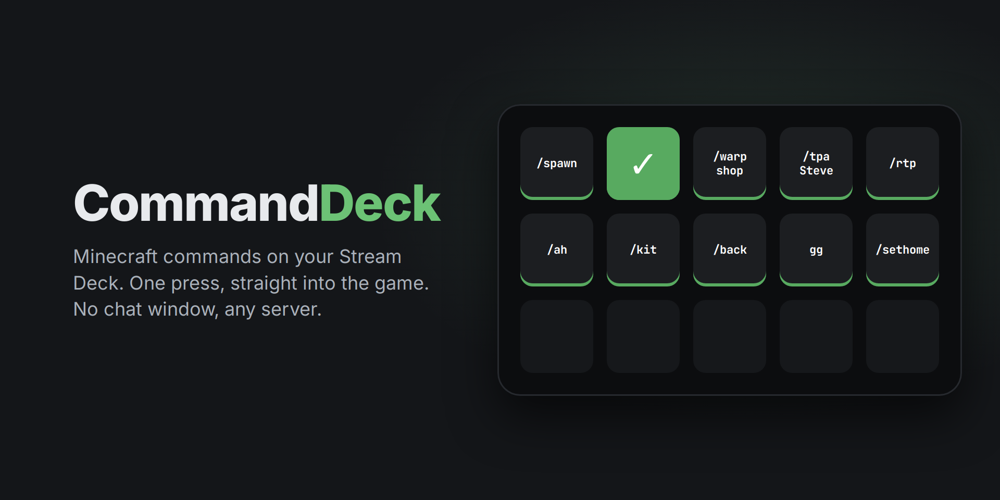

# CommandDeck

[](https://modrinth.com/mod/commanddeck)
[](https://github.com/alexander566/CommandDeck/releases/latest)
[](LICENSE)



Run Minecraft commands from your Stream Deck. Press a key and the command goes straight into the game: no chat window, no typing macro, any server.

CommandDeck has two parts that work together:

- **CommandDeck mod** (Fabric, Quilt, NeoForge, Forge; client side): receives commands from the Stream Deck and sends them as if you typed them.
- **CommandDeck Stream Deck plugin**: a **Command** key you can fill with any command.

Servers don't need to install anything.

## Install

1. Download the files from the [latest release](https://github.com/alexander566/CommandDeck/releases/latest) (the mod is also on [Modrinth](https://modrinth.com/mod/commanddeck)).
2. **Mod:** put the jar for your loader and Minecraft version in your `mods` folder (or get it from [Modrinth](https://modrinth.com/mod/commanddeck), which picks the right one).

   | Minecraft | Fabric / Quilt | NeoForge | Forge |
   |---|---|---|---|
   | 26.1 and newer | `+fabric-mc26.x` | `+neoforge-mc26.x` | `+forge-mc26.x` |
   | 1.20.5 / 1.20.6 – 1.21.11 | `+fabric-mc1.19.3-1.21` | `+neoforge-mc1.20.5-1.21` | `+forge-mc1.20.6-1.21` |
   | 1.19.3 – 1.20.4 | `+fabric-mc1.19.3-1.21` | – | `+forge-mc1.19.3-1.20.4` |
   | 1.19 – 1.19.2 | `+fabric-mc1.19-1.19.2` | – | `+forge-mc1.19.1-1.19.2` (1.19.1+) |
   | 1.18 – 1.18.2 | `+fabric-mc1.14-1.18` | – | `+forge-mc1.18-1.18.2` |
   | 1.14 – 1.17.1 | `+fabric-mc1.14-1.18` | – | – |

   Fabric needs no Fabric API. Quilt uses the Fabric jar.

3. **Stream Deck plugin:** double-click `CommandDeck.streamDeckPlugin`.

## Use

1. In the Stream Deck app, drag **CommandDeck › Command** onto a key.
2. Type a command, for example `/spawn`. The key title follows the command until you set your own title.
3. Join a world and press the key.

- One command per line; they run in order.
- Lines starting with `/` are commands, anything else is sent as a chat message.
- A check mark means it was sent. A warning means the game isn't running, the mod isn't installed, or you aren't in a world yet.
- With several game windows open, the key goes to the newest one that is in a world.

## How it works

When the game starts, the mod listens on `127.0.0.1` on a free port picked by the operating system and writes the port and a random per-launch token to `~/.commanddeck/<pid>.json` (removed when the game closes). The plugin reads that file and posts the command to the game.

- Only reachable from your own computer.
- Every request must carry the token, and requests from web browsers are refused, so websites can't send commands to your game.
- Commands are sent exactly like typed ones. Server rules about macros still apply; use it responsibly.

## Build

Needs JDK 25.

```
./build-all.sh
```

Jars and `CommandDeck.streamDeckPlugin` end up in `dist/`. `mod/common/` is shared by every build; `mod/send/` holds the three ways Minecraft sends chat across versions; `mod/loader/` has one small entry class per loader; each folder in `mod/eras/` builds one jar. Forge 1.20.6+ runs on Mojang names like NeoForge, so `mod/pack-forge-mojmap.sh` reuses the NeoForge classes for it.

## License

[MIT](LICENSE)

Not an official Minecraft product. Not approved by or associated with Mojang or Microsoft.
